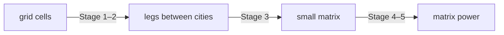
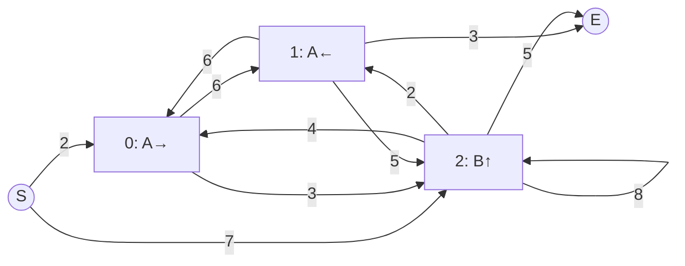
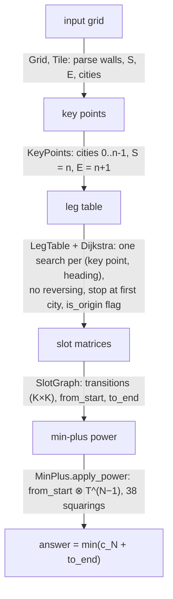

# Day 15, Part 3: Visiting 202,620,262,026 cities

This write-up starts from the puzzle rules and works up to the final solution in [3.py](3.py). It explains each stage of the solution and why each one gives the correct answer.

---

## 1. The puzzle

The input is a grid:

```
#####################################################
#.@.........#................#..........@..........##
#.#########@#.##############.#.###################.##
#.#...@...#.#.##.....@....##.#.###..@..@......@###.##
...
S...................................................E
...
```

| Tile | Meaning |
|---|---|
| `#` | wall |
| `.` | floor |
| `S` | start |
| `E` | end |
| `@` | city |

Rules:

1. Start on `S` and move one cell per step: forward, left or right. **You can never reverse.**
2. Every time you step onto a `@`, that counts as one visit. Revisiting a city counts again.
3. After **202,620,262,026** visits, walk to `E`.
4. Find the minimum total number of steps.

Two things make this hard:

- **No reversing.** Where you can go next depends on which way you're facing, not just where you are.
- **The visit count is huge.** About 2·10¹¹. Any approach that handles one visit at a time is too slow, even at a billion visits per second.

---

## 2. Why a plain search doesn't work

The obvious idea is to run Dijkstra over states like this:

```
(position, heading, visits so far)
```

This state does capture everything that matters. But the real input has about 2,000 cells, 4 headings and 2·10¹¹ possible visit counts, which is far too many states to search.

The solution reduces the problem in stages until it becomes small enough to compute directly:



---

## 3. Stage 1: searching the grid with a heading

*Code: `Direction`, `Point`, `Walker`, `LegTable._neighbours`*

A node in the grid search is a cell plus the direction of the last move:

```
Walker = (position, heading)
```

From a node you can move forward, turn left or turn right, but never back:

```
            forward
               ▲
      left ◄── ● ──► right          heading = NORTH
               ✕
            (back is forbidden)
```

In code, `_neighbours` tries all 4 directions and drops `heading.opposite`. At the start there is no heading yet. That's `Direction.NONE`, and its opposite is also `NONE`, so all 4 moves are allowed on the first step.

**Why the heading must be in the state:** two walkers on the same cell can face completely different futures. Suppose city B is directly behind you. If you're facing it, it's 1 step away. If you're facing away, you may need a long loop to turn around. A search that only knew positions would treat these as the same state and give wrong answers.

---

## 4. Stage 2: legs from city to city

*Code: `KeyPoints`, `Arrival`, `LegTable`*

### 4.1 Only a few cells matter

Most cells are just floor you walk across. The cells that matter are the **key points**: `S`, `E` and every `@`. `KeyPoints` numbers them:

```
0 .. n-1   cities
n          start
n+1        end
```

A walk can be cut into **legs**: one stretch from one key point to the next. If you know the cheapest version of every possible leg, you can forget the grid.

### 4.2 A leg depends on the heading at both ends

Because of the no-reverse rule, the cost of a leg depends on:

- which way you **arrived** at its start (that restricts your first move), and
- which way you **arrive** at its end (that restricts the next leg).

So a leg doesn't go from city to city. It goes from **arrival to arrival**:

```
Arrival = (key point, heading)
```

The leg table stores:

```
legs[(i, d)][(j, d2)] = fewest steps from "at i, arrived heading d"
                        to "at j, arrived heading d2"
```

There is one Dijkstra run per **source** arrival: the start (heading `NONE`) and every city with each of the 4 headings. Each run explores the whole reachable grid (`end=None`), and the targets are read off afterwards.

### 4.3 Rule: a leg ends at the first city it reaches

Every step onto a `@` counts as a visit, including when you're just passing through. A leg that crossed city B on its way from A to C would count 2 visits while looking like 1.

So `_neighbours` treats every city cell as a **dead end**: the search arrives there but does not continue. Every leg therefore contains **exactly one visit**, at its end.

This doesn't rule out any walks. Passing through B on the way to C is still possible: it's the leg A→B followed by the leg B→C.

### 4.4 The `is_origin` flag

The dead-end rule creates a problem. The search for a leg *starts* on a city, so it would stop immediately. The search also needs a different problem fixed: since revisits are allowed, A → … → A (leave and come back) is a valid leg, but the start node already has cost 0, so the cost of returning to it can't be read off.

The fix is a flag in the node:

```
Walker = (position, heading, is_origin)
```

- The source node has `is_origin = True`, so it is allowed to expand.
- Every node produced by `_neighbours` has `is_origin = False`.

`(A, d, True)` and `(A, d, False)` are now different nodes: "leaving A" and "arriving back at A". That solves both problems.

### 4.5 Why using only shortest legs is enough

**Claim:** some optimal walk is made entirely of shortest legs.

**Argument:**

1. Cut any valid walk at every city visit. Each piece is a leg: it starts at an arrival, ends at the next arrival, and has no city in between.
2. Swap each piece for the shortest leg with the **same start arrival and same end arrival**.
3. The swap keeps the end position *and the end heading* the same. So the next piece is still legal from where the new one stops: no reversing is introduced at the joins.
4. The swap doesn't change the number of visits (one per leg) and doesn't increase the cost.

So the cheapest walk overall is a chain of cheapest legs, and the leg table contains everything needed.

This is also why the end heading has to be part of the table. If it weren't, step 3 could fail: the shortest leg might arrive facing a direction that makes the next leg impossible or more expensive.

---

## 5. Stage 3: from leg table to matrices

*Code: `SlotGraph`*

### 5.1 Slots

After Stage 2, every "place you can be after a visit" is a city arrival: a city **plus** the heading you entered it with. Each one gets a number. These numbered arrivals are called **slots**.

The same city can produce several slots. A city in a horizontal corridor can be entered heading east or heading west, which gives 2 slots, and they behave differently because you can't reverse.

### 5.2 A small example

The real input has hundreds of slots, so here is a made-up example with just two cities, `A` and `B`, and three slots:

| Slot | Meaning |
|---|---|
| 0 | at `A`, arrived heading **east** (written `A→`) |
| 1 | at `A`, arrived heading **west** (written `A←`) |
| 2 | at `B`, arrived heading **north** (written `B↑`) |

Stage 2 gives the cost of every leg. As a graph:



How to read a few edges:

- `A→` to `A←`, cost 6: leave `A` heading east, loop around, and come back into `A` heading west. That's a revisit, so it counts as one visit.
- `B↑` to `B↑`, cost 8: a loop that leaves `B` and comes back into it the same way.
- `A→` has no edge to itself and no edge to `E`. Those legs don't exist in this example, for instance because the only way back goes through `B`.

### 5.3 The `transitions` matrix

`transitions` is the same graph written as a table. The **row** is where the leg starts, and the **column** is where it ends:

$$
T =
\begin{array}{c|ccc}
\text{from}\ \backslash\ \text{to} & 0\ (A\!\rightarrow) & 1\ (A\!\leftarrow) & 2\ (B\!\uparrow) \\
\hline
0\ (A\!\rightarrow) & \infty & 6 & 3 \\
1\ (A\!\leftarrow) & 6 & \infty & 5 \\
2\ (B\!\uparrow) & 4 & 2 & 8
\end{array}
$$

So $T[a, b]$ is the cost of one leg from slot $a$ to slot $b$. An entry of $\infty$ means there is no such leg. Using $\infty$ instead of a missing value is what makes the arithmetic later work: $\infty$ plus anything is still $\infty$, so it never wins a minimum.

The first and last legs don't fit into this table, because `S` and `E` are not slots. They get their own vectors:

$$
\text{from\_start} = \begin{pmatrix} 2 & \infty & 7 \end{pmatrix}
\qquad
\text{to\_end} = \begin{pmatrix} \infty & 3 & 5 \end{pmatrix}
$$

- `from_start[b]`: cost of the first leg, from `S` to slot $b$.
- `to_end[a]`: cost of the last leg, from slot $a$ to `E`. (If a slot can reach `E` with several headings, the cheapest is kept, because the heading at `E` no longer matters.)

Once these three arrays exist, the grid is no longer needed. The problem becomes:

> Choose a chain $S \to \text{slot}_1 \to \text{slot}_2 \to \dots \to \text{slot}_N \to E$ with $N$ = 202,620,262,026 that has the lowest total cost.

---

## 6. Stage 4: counting visits

### 6.1 The quantity we track

Define

$$
c_k[b] = \text{cheapest way to make exactly } k \text{ visits and be standing in slot } b
$$

This is a vector with one entry per slot. In the example, after the first leg:

$$
c_1 = \text{from\_start} = \begin{pmatrix} 2 & \infty & 7 \end{pmatrix}
$$

### 6.2 One more visit: "where did the last leg come from?"

Suppose you want $c_2[b]$, the cheapest way to make 2 visits and end in slot $b$.

The second leg ended in $b$, so it **started in some slot $a$**. We don't know which $a$, so we try every one:

$$
\text{cost via } a \;=\; \underbrace{c_1[a]}_{\text{get to } a \text{ with 1 visit}} \;+\; \underbrace{T[a, b]}_{\text{one leg } a \to b}
$$

and keep the cheapest:

$$
c_2[b] = \min_a \big( c_1[a] + T[a, b] \big)
$$

That's all "min over $a$" means: **try every possible previous slot and keep the best one.**

Worked out for $b = 2$ ($B\!\uparrow$):

| previous slot $a$ | $c_1[a]$ | $T[a, 2]$ | total |
|---|---|---|---|
| 0 ($A\!\rightarrow$) | 2 | 3 | **5** |
| 1 ($A\!\leftarrow$) | $\infty$ | 5 | $\infty$ |
| 2 ($B\!\uparrow$) | 7 | 8 | 15 |

So $c_2[2] = 5$: go `S → A→` (2), then `A→ → B↑` (3).

### 6.3 All targets at once

Doing this for every $b$ means building the full table of "cost so far plus next leg", with one row per previous slot $a$ and one column per target $b$:

$$
c_1[a] + T[a, b] =
\begin{array}{c|ccc}
a\ \backslash\ b & 0 & 1 & 2 \\
\hline
0\ (c_1 = 2) & \infty & 8 & 5 \\
1\ (c_1 = \infty) & \infty & \infty & \infty \\
2\ (c_1 = 7) & 11 & 9 & 15 \\
\hline
\min \text{ of column} & \mathbf{11} & \mathbf{8} & \mathbf{5}
\end{array}
$$

Each row is $T$'s row with that slot's current cost added to every entry. Then the minimum of each column is taken. The column minimums form the new vector:

$$
c_2 = \begin{pmatrix} 11 & 8 & 5 \end{pmatrix}
$$

This is exactly what the numpy line in `MinPlus.vec_mul` does:

```python
cost = (cost[:, None] + transitions).min(axis=0)
```

| numpy | meaning |
|---|---|
| `cost[:, None]` | turn the vector into a column, so entry $a$ is added to all of row $a$ |
| `+ transitions` | build the "cost so far plus next leg" table above |
| `.min(axis=0)` | take the minimum down each column, so the best previous slot for each target |

### 6.4 Why this is correct

To reach slot $b$ with $k+1$ visits, the last leg must come from some slot $a$ reached with $k$ visits. What happened before $a$ doesn't matter for the rest of the walk: only the slot (position plus heading) and the visit count affect what you can do next. So the best way to reach $b$ is the best way to reach some $a$, plus the leg $a \to b$, and taking the minimum over all $a$ covers every possibility.

### 6.5 Repeating and finishing

The same update moves from $k$ to $k+1$ visits each time:

$$
c_{k+1}[b] = \min_a \big( c_k[a] + T[a, b] \big)
$$

After $N$ visits, add the last leg to `E` and take the best slot:

$$
\text{answer} = \min_a \big( c_N[a] + \text{to\_end}[a] \big)
$$

In the example with $N = 2$:

$$
\min\big(11 + \infty,\; 8 + 3,\; 5 + 5\big) = \min(\infty, 11, 10) = 10
$$

which is the walk `S → A→ → B↑ → E` with legs 2 + 3 + 5.

For Part 2 ($N = 2026$), running this update 2025 times takes milliseconds. For Part 3 it would need 2·10¹¹ updates, which is far too many.

---

## 7. Stage 5: the update is a matrix product

### 7.1 Min-plus algebra

Compare the update with an ordinary vector × matrix product:

$$
\text{ordinary:}\quad \text{new}[b] = \sum_a v[a] \cdot M[a, b]
\qquad\qquad
\text{ours:}\quad \text{new}[b] = \min_a \big( v[a] + M[a, b] \big)
$$

It's the same shape, with **sum → min** and **times → plus**. This is the *min-plus* (or tropical) product, written $\otimes$. Running $N-1$ updates is:

$$
c_N = c_1 \otimes \underbrace{T \otimes T \otimes \dots \otimes T}_{N-1} = c_1 \otimes T^{N-1}
$$

The matrix version (`MinPlus.mat_mul`) is:

$$
(A \otimes B)[a, b] = \min_m \big( A[a, m] + B[m, b] \big)
$$

It means: go from $a$ to some middle slot $m$ using $A$'s legs, then from $m$ to $b$ using $B$'s legs, and keep the best $m$. So:

> $T^k[a, b]$ = cheapest way to get from slot $a$ to slot $b$ in exactly $k$ legs (= $k$ visits).

Example: $T^2[0, 1]$, from $A\!\rightarrow$ to $A\!\leftarrow$ in exactly 2 legs:

$$
T^2[0,1] = \min\big(\underbrace{\infty + 6}_{\text{via } 0},\; \underbrace{6 + \infty}_{\text{via } 1},\; \underbrace{3 + 2}_{\text{via } 2}\big) = 5
$$

which is `A→ → B↑ → A←`.

### 7.2 Why grouping doesn't matter

Ordinary matrix multiplication is associative because multiplication distributes over addition:

$$
x \cdot (y + z) = x \cdot y + x \cdot z
$$

Min-plus has the same property, because addition distributes over min:

$$
x + \min(y, z) = \min(x + y,\; x + z)
$$

So $(A \otimes B) \otimes C = A \otimes (B \otimes C)$. This means we can compute $T^{N-1}$ in any grouping we like, and the result is the same.

### 7.3 Exponentiation by squaring

Since grouping doesn't matter, repeated squaring works:

$$
T^1,\; T^2 = T^1 \otimes T^1,\; T^4 = T^2 \otimes T^2,\; T^8,\; T^{16},\; \dots
$$

Write $N - 1$ in binary and apply the powers whose bit is set:

$$
N - 1 = 202{,}620{,}262{,}025 \approx 2^{37.6} \quad\Rightarrow\quad 38 \text{ bits}
$$

```python
power = T
while exponent > 0:
    if exponent & 1:
        vector = vec_mul(vector, power)    # apply this power of two
    power = mat_mul(power, power)          # next power of two
    exponent >>= 1
```

That's **38 squarings instead of 2·10¹¹ updates**. The full matrix $T^{N-1}$ is never built: each power is applied straight to the vector. All the powers are powers of the same $T$, so the order they're applied in doesn't matter.

### 7.4 The final answer

$$
\text{answer} = \min_a \big( c_N[a] + \text{to\_end}[a] \big)
$$

```python
answer = int((cost_N + to_end).min())
```

The matrices use float64 so that `inf` can mean "no leg". Float64 stores integers exactly up to about $9 \cdot 10^{15}$, and the answers are around $10^{11}$, so no rounding occurs.

---

## 8. The whole pipeline


